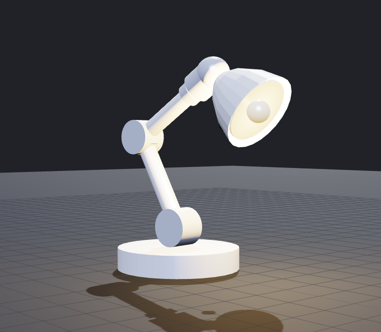

# 💡 5-DOF Lamp Robot Character Simulation

An expressive, embodied lamp robot character inspired by Pixar's *Luxo Jr.*, designed to interact naturally with people using computer vision, offline speech recognition, local language reasoning, dynamic physical motion, and multi-modal sensory cues.

Built for the **Character Robot Challenge**, this system runs **100% offline and locally** on standard commodity hardware (specifically targeting an Ubuntu 24.04 LTS environment with 4 CPU cores, 8 GB RAM, and no discrete GPU).



---

## 🌟 Overview & Key Concepts

Rather than treating the robot as a thin chatbot wrapper or letting an LLM blindly guess raw motor joint voltages, this project establishes a clean, production-grade boundary between **Cognition** (what the character wants to do) and the **Authoritative Body Runtime** (how the body safely realizes that intent).

```
 ┌─────────────────────────────────────────────────────────────┐
 │                      LAPTOP COGNITION                       │
 │   • OpenCV Face Tracking      • Vosk Offline STT            │
 │   • Moondream Vision (Ollama) • Qwen2:0.5B Reasoning        │
 │   • Goal-Directed Observe-Act-Reobserve State Machine       │
 └──────────────────────────────┬──────────────────────────────┘
                                │ JSON BodyCommand
                                ▼ (TCP Socket :8765)
 ┌─────────────────────────────────────────────────────────────┐
 │                AUTHORITATIVE BODY RECEIVER                  │
 │   • Sequence Tracking         • Enum Clamping & Validation  │
 │   • Whole-Command Timeouts    • Graceful Fault Recovery     │
 └──────────────────────────────┬──────────────────────────────┘
                                │ Joint Targets & Multi-Modal Cues
                                ▼
 ┌─────────────────────────────────────────────────────────────┐
 │                PHYSICAL & EXPRESSIVE BODY                   │
 │   • PyBullet 5-DOF Kinematics & Trajectory Interpolation    │
 │   • Lamp Shade RGB Lighting (Warm / Thinking / Success)     │
 │   • Cross-Platform PCM Synthesized Sound FX & Melodies      │
 │   • Local Text-to-Speech (pyttsx3)                          │
 └──────────────────────────────┬──────────────────────────────┘
                                │ Telemetry & Settling Errors
                                ▼
                   measurements.jsonl & Verification
```

---

## ✨ Features & Latest Capabilities

### 1. 🎭 5-DOF Articulated Physical Body
- Driven in PyBullet physics using the official URDF specification with a stable fixed base.
- Expressive motion primitives (`nod`, `shake_head`, `look_left`, `look_right`, `search`, `neutral`).
- Smooth cubic/cosine trajectory interpolation to avoid jerky motor snaps and simulate organic character weight and momentum.

### 2. 💡 Multi-Modal Expression Cues
The lamp communicates its internal state through a synchronized blend of senses:
- **Light Cues**: Dynamically alters the lamp shade's emissive color in PyBullet:
  - 🟡 `warm` (comfortable idle/engagement)
  - 🔵 `thinking` (reasoning or actively scanning the scene)
  - 🟢 `success` (goal satisfied / object found)
  - 🔴 `error` (timeout, missing target, or confusion)
- **Sound Effects & Musical Melodies**: Generates pure-tone synthesized PCM audio (chirps, confirmation chimes, alert tones, and curious ascending melodies) without relying on external MP3 assets. Works cross-platform on Linux ALSA, macOS, and Windows.
- **Voice**: Speaks contextual responses aloud via offline local text-to-speech (`pyttsx3`).

### 3. 🛡️ Strict JSON Protocol & TCP Transport Boundary
- **`protocol.py`**: Defines strictly typed schemas (`BodyCommand` and `BodyResult`) with safe intent clamping. Cognition cannot command unsafe angles or undefined behaviors.
- **`transport.py`**: Runs a dedicated TCP client/server interface (default port `8765`). Cognition and physical simulation can run in separate processes or separate machines over a network.
- **`body_receiver.py`**: An authoritative hardware arbiter that verifies sequence numbers, enforces strict execution deadlines (whole-command timeouts), handles exceptions cleanly, and reports joint settling errors (<0.15 rad).

### 4. 🧠 Goal-Directed Observe–Act–Reobserve Loop
- Extracts target objects and intent from natural spoken language (e.g. *"Can you find my yellow notebook?"* or *"Where is the mug?"*).
- **Pre-Observation**: Captures a visual snapshot of the scene before acting.
- **Scene-Aware Action**: If the object is already present, it confirms discovery immediately. If missing, it commands an active search sweep (`search`), emits curious musical tones, and sets its light to `thinking`.
- **Post-Observation & Verification**: Re-observes the scene after movement settles to verify whether the target object appeared or changed state.
- Logs structured interaction records and verification statuses into `measurements.jsonl`.

### 5. 🔒 100% Offline & Private AI Stack
- **Vision**: Moondream (compact vision-language model running locally via Ollama).
- **Reasoning**: Qwen2:0.5B (local lightweight LLM via Ollama for zero-cloud latency).
- **Speech-to-Text**: Vosk English model (`vosk-model-small-en-us`) for low-latency offline voice transcription.
- **Face Engagement**: Real-time OpenCV Haar cascade face detection with debounce hysteresis to prevent rapid flickering between engaged/disengaged states.

---

## 🚀 Getting Started

### Prerequisites

The project runs on **Ubuntu 24.04 LTS** (recommended), **macOS**, and **Windows 10/11**.

On Ubuntu / Debian systems, install the audio, video, and compilation libraries:
```bash
sudo apt update
sudo apt install -y python3-pip python3-dev portaudio19-dev espeak-ng ffmpeg alsa-utils curl wget git
```

### 1. Clone the Repository

```bash
git clone https://github.com/zetss125/lamp-robot-challenge.git
cd lamp-robot-challenge
```

### 2. Set Up Python Environment

Create a virtual environment and install the dependencies:
```bash
python3 -m venv venv
source venv/bin/activate  # On Windows: .\venv\Scripts\activate
pip install -r requirements.txt
```

### 3. Download the Local Offline Models

The character uses small, open-source models that run efficiently on standard CPU cores:

#### A. Vosk Speech-to-Text Model (~40 MB)
Download and unzip the lightweight English speech model into a root folder named `model`:
```bash
wget https://alphacephei.com/vosk/models/vosk-model-small-en-us-0.15.zip
unzip vosk-model-small-en-us-0.15.zip
mv vosk-model-small-en-us-0.15 model
rm vosk-model-small-en-us-0.15.zip
```

#### B. Ollama Vision & Reasoning Models
Install [Ollama](https://ollama.com/) if you haven't already:
```bash
curl -fsSL https://ollama.com/install.sh | sh
```
Then pull the two compact local models:
```bash
ollama pull moondream
ollama pull qwen2:0.5b
```

---

## 🎮 Running the Simulation

Ensure Ollama is running in the background (`ollama serve` or standard service), then launch the simulation:

```bash
python3 main.py
```

### Environment Flags (Headless & Virtual Machines)

If you're running inside a virtual machine, CI container, or on a machine without a physical webcam:

| Flag | Purpose | Example |
|---|---|---|
| `FORCE_ENGAGEMENT=1` | Bypasses camera face detection and simulates user engagement, enabling full cognition, speech, and goal testing. | `FORCE_ENGAGEMENT=1 python3 main.py` |
| `PYBULLET_DIRECT=1` | Runs PyBullet physics in headless direct mode without opening an OpenGL X11 window. | `PYBULLET_DIRECT=1 python3 main.py` |

---

## 🧪 Testing & Verification

The project includes an automated test suite with **21 comprehensive unit and integration tests** covering the entire stack.

Run the test suite with:
```bash
python3 -m unittest discover -s tests -v
```

### What the Test Suite Verifies

| Test Suite | File | What It Covers |
|---|---|---|
| **Protocol** | `tests/test_protocol.py` | JSON serialization/deserialization, enum validation, clamping invalid actions to safe defaults, timeout boundary checks (`0 < timeout <= 30s`). |
| **Transport Boundary** | `tests/test_transport.py` | Client/server message round-trips over loopback TCP sockets, network disconnect handling, rejection of invalid payloads. |
| **Authoritative Receiver** | `tests/test_body_receiver.py` | Sequence number monotonicity, rejection of out-of-order commands, simulated execution timeouts, hardware exception handling. |
| **Action Controller** | `tests/test_action_controller.py` | PyBullet motion execution, lamp shade RGB color cues, Linux-safe PCM audio tone synthesis, TTS speech budget. |
| **Runtime & Verification** | `tests/test_runtime_and_verification.py` | Spoken target extraction, scene-aware planning (acknowledging existing objects vs. searching for missing items), observe-act-reobserve verification, and clean shutdown lifecycle coordination. |

---

## 📊 Telemetry & Raw Measurements

Every live interaction event—including pre-observations, commanded actions, body execution telemetry, post-observations, and verification verdicts—is automatically appended as JSON to `measurements.jsonl`.

Example recorded entry:
```json
{
  "goal_id": "e12a4501-44bb-4e92-b210-998811223303",
  "is_goal_directed": true,
  "target_object": "yellow notebook",
  "speech": "can you find my yellow notebook",
  "pre_observation": {
    "engaged": true,
    "objects": ["person", "laptop", "mug"],
    "timestamp": 1728537024.1
  },
  "command": {
    "seq": 3,
    "action": "search",
    "light": "thinking",
    "sound": "chirp",
    "music": "curious",
    "speech": "Looking around to locate the yellow notebook.",
    "timeout_s": 8.0
  },
  "body_result": {
    "seq": 3,
    "accepted": true,
    "completed": true,
    "status": "completed",
    "measurements": {
      "action": "search",
      "duration_ms": 1150,
      "joint_error_rad": 0.024,
      "timed_out": false
    }
  },
  "post_observation": {
    "engaged": true,
    "objects": ["person", "laptop", "mug", "yellow notebook"],
    "timestamp": 1728537025.68
  },
  "verification": {
    "completed": true,
    "goal_satisfied": true,
    "body_completed": true,
    "execution_valid": true,
    "reobserved": true,
    "target_in_pre": false,
    "target_in_post": true,
    "reason": "target_confirmed_present"
  }
}
```

---

## 📁 Repository Layout

```
.
├── action_controller.py               # Dispatches PyBullet motion, RGB lights, PCM audio, and TTS
├── body_receiver.py                   # Authoritative body state machine and safety validator
├── brain.py                           # LLM reasoning bounded to strict action enums (Qwen2:0.5B)
├── CHALLENGE.md                       # Original challenge prompt and requirements
├── generate_pdf.py                    # Script to build the standalone deployment PDF
├── main.py                            # Observe-act-reobserve runtime and lifecycle manager
├── measurements.jsonl                 # Logged interaction and verification records
├── perception.py                      # Face tracking, Vosk offline STT, and Moondream VLM
├── protocol.py                        # Strict JSON schemas (BodyCommand, BodyResult)
├── README.md                          # Project documentation and guide
├── requirements.txt                   # Python package dependencies
├── robot/
│   ├── assets/lamp_shade.stl          # Mesh for lamp shade end-effector
│   ├── dummy-lamp.png                 # Diagram of 5-DOF robot character
│   └── dummy_lamp_5dof.urdf           # Kinematic URDF definition
├── simulation.py                      # PyBullet environment setup and joint control
├── SUBMISSION.md                      # Detailed technical submission report
├── tests/                             # Unit & integration test suite (21 tests)
│   ├── test_action_controller.py
│   ├── test_body_receiver.py
│   ├── test_protocol.py
│   ├── test_runtime_and_verification.py
│   └── test_transport.py
├── transport.py                       # TCP socket client/server boundary
└── UBUNTU_DEPLOYMENT_INSTRUCTIONS.pdf # Printable PDF guide for Ubuntu deployment
```

---

## 🔧 Troubleshooting Tips

- **TCP Port in Use (`Address already in use: 8765`)**:
  If a previous run was abruptly halted, free the port with `lsof -i :8765` and `kill -9 <PID>`, or wait a few seconds for the operating system socket `TIME_WAIT` state to clear.
- **Ollama Connection Refused**:
  Check that Ollama is active by running `ollama list`. If not running, start it with `ollama serve`.
- **Speech Recognition Silently Skipped**:
  Verify the Vosk model directory exists at `./model` and contains files such as `am/`, `conf/`, and `graph/`.
- **No Sound Output in VM**:
  Ensure audio pass-through (such as Intel HD Audio or PulseAudio/ALSA) is enabled in your VM hypervisor settings.

---

## 📜 License & Acknowledgments

Developed as a demonstration of embodied character robotics, strict systems engineering boundaries, and offline multimodal interaction.
URDF assets and lamp challenge specifications provided by the challenge organizers.
