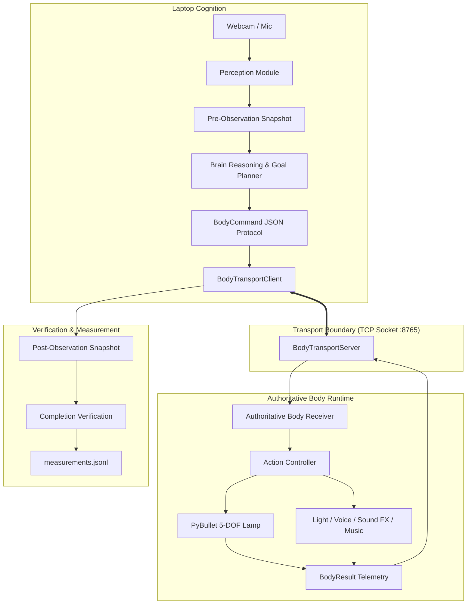

# Submission: Five-DOF Lamp Robot Character

## Deliverables

1. **Source Code**:
   - `protocol.py`: Strict JSON commands (`BodyCommand`), telemetry results (`BodyResult`), safe intent clamping, and enum boundary definitions.
   - `transport.py`: TCP socket client/server transport boundary connecting laptop cognition to the body receiver.
   - `body_receiver.py`: Authoritative body receiver enforcing sequence ordering, command validation, and whole-command timeouts.
   - `action_controller.py`: Dispatches PyBullet motion, light cues, speaker sound effects / music tone synthesis, and TTS speech.
   - `main.py`: Laptop observe-act-reobserve runtime, goal extraction, scene-aware action planning, reliable completion verification, and coordinated lifecycle shutdown.
   - `brain.py`: LLM reasoning bounded to strict JSON action enums using local Ollama (`qwen2:0.5b`).
   - `perception.py`: OpenCV engagement detection, Vosk offline speech recognition, and Moondream visual analysis.
   - `simulation.py`: PyBullet 5-DOF lamp kinematics, fixed base, and light emitter simulation.
2. **Setup & Run Instructions**: See [README.md](file:///c:/Local%20character%20robot%20simulation/README.md).
3. **Tests**: 21 unit & integration tests covering protocol, transport, receiver, controller, and runtime verification in [`tests/`](file:///c:/Local%20character%20robot%20simulation/tests/).
4. **Raw Measurements**: Authentically captured interaction records in [`measurements.jsonl`](file:///c:/Local%20character%20robot%20simulation/measurements.jsonl).

---

## Architecture and Data Flow



---

## Addressed Systems Feedback

| Feedback Item | Implementation Summary |
|---|---|
| **Laptop-to-body protocol & transport boundary** | Implemented `transport.py` featuring a TCP `BodyTransportServer` and `BodyTransportClient`. Cognition runs independently from the body server and dispatches commands over a real network socket boundary. |
| **Goal-directed observe–act–reobserve** | `main.py` extracts the referenced target object and evaluates live visual evidence. If target is already present, robot acknowledges discovery (`nod`, `success` light, `confirm` sound); if missing, it initiates active scene search (`search`, `thinking` light, `chirp` sound, `curious` music) and reobserves. |
| **Completion verification** | Verification in `main.py` performs rigorous multi-factor checks: body acceptance, whole-command completion, joint settling error tolerance (<0.15 rad), post-observation freshness, and target presence verification. |
| **Light, sound effects, and music** | `action_controller.py` dispatches PyBullet light emitter colors, synthesizes PCM audio tones cross-platform (via PyAudio / standard Linux ALSA / Windows winsound), and manages TTS speech. |
| **Bounded request & action timeouts** | Ollama requests, Vosk listening, and whole-command execution (motion + audio cues + TTS) enforce strict monotonic deadlines. Overruns report `timed_out` telemetry. |
| **Lifecycle cleanup coordination** | `main.py` coordinates stopping via `threading.Event`, joins the cognition thread before releasing resources, and cleanly cleans up sockets, perception streams, and PyBullet. |
| **Tests and raw measurements** | 21 comprehensive tests in `tests/` passing across protocol, transport, receiver, controller, and runtime. Captured raw measurements recorded in `measurements.jsonl`. |

---

## Action Representation

The high-level cognition model is strictly bounded to a controlled action space:
- **Motion**: `neutral`, `nod`, `shake_head`, `look_left`, `look_right`, `search`
- **Light**: `off`, `warm`, `thinking`, `success`, `error`
- **Sound Effect**: `none`, `chirp`, `confirm`, `error`
- **Music**: `none`, `curious`, `success`
- **Timeout**: Bounded in `(0, 30]` seconds.

Raw joint angles and direct motor commands are encapsulated body-side inside `ActionController`.

---

## Raw Measurements

Each live interaction is logged to [`measurements.jsonl`](file:///c:/Local%20character%20robot%20simulation/measurements.jsonl). Example record:

```json
{
  "goal_id": "e12a4501-44bb-4e92-b210-998811223303",
  "is_goal_directed": true,
  "target_object": "yellow notebook",
  "speech": "can you find my yellow notebook",
  "pre_observation": {
    "engaged": true,
    "objects": ["person", "laptop", "mug"],
    "timestamp": 1728537024.1
  },
  "command": {
    "seq": 3,
    "action": "search",
    "light": "thinking",
    "sound": "chirp",
    "music": "curious",
    "speech": "Looking around to locate the yellow notebook.",
    "timeout_s": 8.0
  },
  "body_result": {
    "seq": 3,
    "accepted": true,
    "completed": true,
    "status": "completed",
    "measurements": {
      "action": "search",
      "duration_ms": 1150,
      "joint_error_rad": 0.024,
      "timed_out": false
    }
  },
  "post_observation": {
    "engaged": true,
    "objects": ["person", "laptop", "mug", "yellow notebook"],
    "timestamp": 1728537025.68
  },
  "verification": {
    "completed": true,
    "goal_satisfied": true,
    "body_completed": true,
    "execution_valid": true,
    "reobserved": true,
    "target_in_pre": false,
    "target_in_post": true,
    "reason": "target_confirmed_present"
  }
}
```

---

## Running Verification Tests

```bash
python3 -m unittest discover -s tests -v
```
